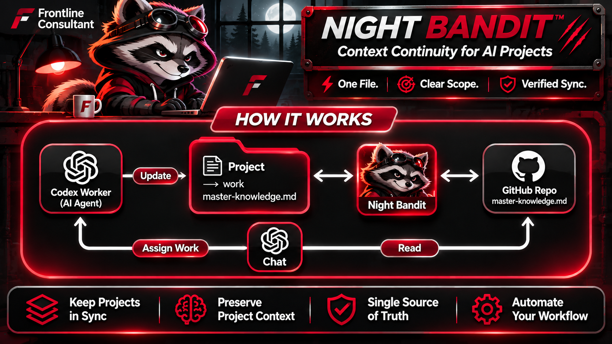

<p align="center">
  
</p>

# NIGHT BANDIT

### One file. Clear scope. Verified sync.

A Windows desktop tool from [Frontline Consultant](https://frontlineconsultant.com) that synchronizes one explicitly selected text file to GitHub. Review the scope, run a dry-run, and authorize a session. Follow each change through local history, diffs and remote verification.

[How To on Frontline](https://frontlineconsultant.com/docs/night-bandit-how-to) · [Latest release](https://github.com/kjohnsonthecoder/Night-Bandit/releases/latest) · [Setup](#download-and-run) · [Workflow](#first-repository) · [Updates](#check-for-updates)

| Focused automation | Visible control | Traceable results |
| --- | --- | --- |
| One selected text file per scope | Reviewed dry-run and session approval | Local history, diffs and verified remote success |
| Windows tray listener | Stop and Exit controls | Clear activity and recovery blockers |

**Version 0.3.1 — early source release.** Code and branding are **all rights reserved**, not open source. Third-party fonts retain their own licenses. No subscription is required.

## Availability

Source is available here. **General-public GitHub App authorization is not yet verified.** The bundled public Client ID is not a secret, but downloading this code does not grant access to the App. If GitHub denies authorization or installation, stop and contact the maintainer; do not enter someone else's token, change permissions, or bypass checks. This limitation may prevent new users from connecting repositories until the maintainer completes public onboarding.

## Requirements

- Windows 10/11, a desktop session, Python with Tkinter, and Git for Windows on PATH.
- Tested with Python 3.15 on Windows. Other Python versions have not been certified.
- An existing GitHub repository and local checkout with an existing tracked, nonempty UTF-8 text file (up to 8 MiB).
- Your Git author name/email configured for commits and suitable repository access through the GitHub App.

Python and Git are separate prerequisites. Application modules, artwork and fonts are included; no third-party Python packages are required. This is not an installer or signed executable. Windows may show reputation or downloaded-file warnings; verify the source and follow your organization's policy.

## Download and run

Use a dedicated APPLICATION folder, separate from repositories you want to monitor:

```powershell
git clone https://github.com/kjohnsonthecoder/Night-Bandit.git
cd Night-Bandit
pythonw -B run-night-bandit.pyw
```

For startup diagnostics, run `python -B run-night-bandit.pyw` in a terminal. Application preferences and protected authentication state are stored under `%LOCALAPPDATA%\Frontline\NightBanditDesktop`, outside the source checkout. Never commit or share that directory.

## First repository

1. Press **Add Repository**. A fresh application has no repository workspaces.
2. Choose **GitHub** and follow device authorization. No Client ID or secret entry is needed. GitLab and Bitbucket are disabled as Coming Soon.
3. Select an authorized repository, its existing local checkout, and one tracked file. Review the exact remote, branch and file. This desktop release does not clone repositories or initialize empty repositories.
4. Run **safe dry-run**. It must pass before synchronization. Resolve dirty-file exclusions, divergence, permissions or recovery blockers without deleting locks or discarding work.
5. Press **Start Automatic Sync** and approve the displayed scope for this session. Existing unsynchronized edits are included. Only that file is eligible for commits and normal pushes; success is shown after remote verification.
6. **Stop** ends the session after its current operation. Closing an active window keeps the listener in the tray; **Exit** stops it. Opening the application does not start synchronization, and no Windows startup service/task is installed.

Configure multiple workspaces with independent names, icons, paths and audit records. **One automatic session runs at a time.** Stop before switching execution scopes. Day/week/month/year history reflects commits reachable from the local branch; click a commit for its diff. The calendar does not fetch remote-only history.

## Check for updates

Settings → **Check for updates** compares this version with the latest stable GitHub Release. The check is anonymous, sends no repository credentials or file contents, and never downloads or installs code. No release yet, offline, rate-limit and malformed responses are reported distinctly.

Read release notes, then Stop and Exit every NIGHT BANDIT instance before updating. In the original APPLICATION checkout, verify:

```powershell
git remote get-url origin
git branch --show-current
git status --short
```

Proceed only when origin is this public repository, branch is `main`, and the working tree is clean. Preserve your own edits separately if these checks fail; do not reset or force an update. Never run the application update command inside a monitored repository.

```powershell
git pull --ff-only origin main
pythonw -B run-night-bandit.pyw
```

If Git refuses the pull, stop and review; do not force, reset or discard changes. After updating, run a dry-run and explicitly authorize the next automatic session. Changes requiring a different Python/Git version will be called out in release notes. No MSIX updater is included.

## Safety and privacy

- Exact-file scope, reviewed exclusions, fresh-source checks, branch/index/remote validation, transaction journals and audit records remain enforced.
- Divergence, foreign locks or unexpected changes block synchronization. Recovery must be reviewed; never delete a lock merely to silence an error.
- Authentication is protected with current-user Windows DPAPI. Do not share credentials, local profiles, audit logs or diagnostic exports without reviewing them.
- There is no marketing enrollment, telemetry uploader or automatic update installer. Repository access is used only for explicit connection and synchronization operations.
- This public source package contains no operator profiles, private repository history, checkpoints, credentials or customer data.

## Tests

From the application checkout:

```powershell
python -B -m unittest discover -s tests -v
```

Tests use synthetic temporary Git repositories. Some tests open short-lived Tk windows and require a Windows desktop. See [CHANGELOG.md](CHANGELOG.md), [LICENSE](LICENSE) and [THIRD_PARTY_NOTICES.md](THIRD_PARTY_NOTICES.md).
